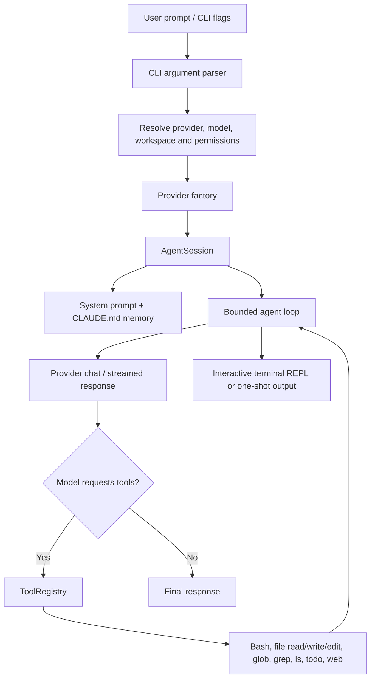

# My Claude Code — Multi-Provider Agentic Coding CLI

A terminal-based coding assistant built in TypeScript. It combines a persistent agent session, multi-provider model adapters, a workspace-aware tool registry, project memory through CLAUDE.md, and both interactive REPL and one-shot CLI workflows.


## Why it matters

Coding agents need more than a chat loop. They must inspect a workspace, use tools, retain project conventions, support different model providers, and expose the actions they are taking. This project explores those building blocks in a locally run CLI.

## Architecture



## What is implemented

- Interactive REPL with workspace and model context.
- One-shot mode through the print CLI option.
- Provider adapters for Anthropic, OpenAI, Gemini, and DeepSeek.
- Agent loop with streamed output, tool-call execution, and a bounded 25-iteration turn.
- Workspace tools: Bash, file read/write/edit, glob, grep, directory listing, todo tracking, and web fetch.
- Plan mode for read-only planning.
- Project guidance loaded from CLAUDE.md.
- Slash commands for help, clear, compact, cost, doctor, init, plan, and exit.

## Quick start

Requirements: Node.js, npm, and an API key for at least one supported provider.

```bash
git clone https://github.com/MokuLakshithReddy/my-claude-code.git
cd my-claude-code
npm install
npm run build
cp .env.example .env
```

Add one provider key to the local .env file:

```env
ANTHROPIC_API_KEY=your_key
# Or configure OPENAI_API_KEY, GEMINI_API_KEY, or DEEPSEEK_API_KEY
```

Keep private API keys in your local environment. Do not commit .env files or paste keys into source code.

Run interactively:

```bash
npm start
```

Run a one-shot prompt:

```bash
node bin/myclaude.js -p "Explain the structure of this repository"
```

Run tests:

```bash
npm test
```

## Safety notes

Tool execution can read and modify files or run shell commands in the selected workspace. Review tool actions and keep permission prompts enabled for unfamiliar repositories. The auto-approve flag deliberately bypasses interactive approvals and should only be used in trusted, isolated environments.

## Evidence status

The package defines a Node.js test-runner command, but this README does not claim a test count, coding benchmark, or model-quality score. Publish those only with a reproducible test run and the exact model/configuration used.

[Browse the source](https://github.com/MokuLakshithReddy/my-claude-code)
